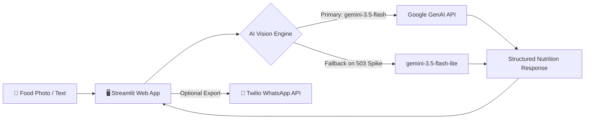

<div align="center">

# 🥗 Neutri-Scan (MacroSnap)

**Intelligent Visual Food Recognition, Ingredient Breakdown & Macronutrient Analysis**

[](https://www.python.org/)
[](https://streamlit.io/)
[](https://ai.google.dev/)
[](https://www.twilio.com/)
[](LICENSE)

*Snap a photo of your meal. Get instant calorie estimates, protein breakdown, identified ingredients, and actionable health insights in seconds.*

[Features](#-key-features) • [Quick Start](#-quick-start) • [Architecture](#-architecture) • [Configuration](#-configuration) • [Sample Output](#-sample-output)

</div>

---

## 📖 Overview

**Neutri-Scan** (powered by MacroSnap) is a modern AI-driven nutrition assistant. Instead of tediously searching food databases and manually calculating serving sizes, users simply upload or snap a photo of any meal, snack, or ingredient.

Using Google's state-of-the-art **Gemini Vision models**, Neutri-Scan identifies the dish, estimates portion sizes, extracts the complete list of ingredients, calculates calories and macronutrients (with an emphasis on protein), and highlights micronutrients, allergens, and dietary tags. Optionally, users can send their daily nutrition breakdown straight to **WhatsApp** with one click.

---

## ✨ Key Features

- 📸 **Visual Food Recognition**: Upload images (`.jpg`, `.jpeg`, `.png`) or describe meals in natural language.
- 🥗 **Comprehensive Ingredient Detection**: Automatically identifies visible and estimated ingredients with approximate quantities.
- 📊 **Precision Macro Breakdown**:
  - **Calories**: Estimated total energy intake in kcal.
  - **Protein**: Clearly highlighted to support fitness and muscle-building goals.
  - **Carbohydrates & Fats**: Breakdown including dietary fiber, natural sugars, and healthy vs. saturated fats.
- 💡 **Extra Dietary & Health Insights**:
  - **Micronutrients & Vitamins**: Highlights essential nutrients like Vitamin A, Vitamin C, Iron, Calcium, and Potassium.
  - **Dietary Badges**: Automatically tags meals (e.g., *High-Protein*, *Low-Carb*, *Vegan*, *Gluten-Free*).
  - **Allergen Warnings**: Proactively flags common allergens (dairy, nuts, gluten, soy, eggs, shellfish).
  - **Actionable Health Tips**: Actionable tips to balance meals (e.g., adding fiber or healthy fats).
- 🛡️ **Fault-Tolerant Engine (High Availability)**:
  - Built-in exponential backoff retry logic to handle temporary traffic spikes.
  - Automatic model failover from `gemini-3.5-flash` to `gemini-3.5-flash-lite` while seamlessly preserving chat history.
- 📲 **WhatsApp Sync (Optional)**: Export structured daily meal summaries directly to your phone via Twilio WhatsApp API.
- 🔄 **Quick Session Reset**: Start new meals or clear conversation logs with a single click.

---

## 🏗️ Architecture



---

## 📋 Sample Output

When you upload a meal photo (e.g., a Greek yogurt bowl with fruit and nuts), Neutri-Scan delivers:

```markdown
### 🍽️ Dish & Portion
- **Identified Item**: Greek Yogurt Bowl with Berries & Almonds
- **Estimated Portion**: 1 medium bowl (~250g)

### 🥗 Ingredients Identified
- Plain Greek yogurt: ~200g
- Fresh blueberries: ~40g
- Sliced almonds: ~15g
- Honey drizzle: ~1 tbsp (~15g)

### 📊 Macronutrient Breakdown
- **Calories**: ~320 kcal
- **Protein**: ~20g ⚡
- **Carbohydrates**: ~32g (Fiber: ~3.5g, Natural Sugars: ~24g)
- **Fats**: ~12g (Rich in monounsaturated fats)

### 💡 Extra Nutritional Insights
- **Key Micronutrients & Vitamins**: Calcium, Vitamin C, Vitamin E, Magnesium, Probiotics
- **Health Profile & Diet Tags**: High-Protein, Vegetarian, Gluten-Free
- **Allergen Alert**: Contains Dairy (Yogurt), Tree Nuts (Almonds)
- **Quick Health Tip**: Swap the honey for a pinch of cinnamon to lower sugars while boosting antioxidants!
```

---

## 📁 Project Structure

```text
Neutri-Scan/
├── .streamlit/
│   ├── secrets.toml          # Secret keys (Git-ignored)
│   └── secrets.toml.example  # Configuration template
├── app.py                    # Main Streamlit web application
├── prompts.py                # AI system instructions and templates
├── requirements.txt          # Python dependencies
├── .gitignore                # Protects secrets, cache, and virtual environments
└── README.md                 # Project documentation
```

---

## 🚀 Quick Start

### 1. Prerequisites
- **Python 3.10+** installed on your system.
- A **Google Gemini API Key** from [Google AI Studio](https://aistudio.google.com/).

### 2. Clone the Repository
```bash
git clone https://github.com/Narendra-1715/Neutri-Scan.git
cd Neutri-Scan
```

### 3. Create and Activate Virtual Environment
```bash
# On Windows:
python -m venv venv
venv\Scripts\activate

# On macOS / Linux:
python3 -m venv venv
source venv/bin/activate
```

### 4. Install Dependencies
```bash
pip install -r requirements.txt
```

### 5. Configure API Secrets
Create a `.streamlit/secrets.toml` file in the project root:

```bash
# On Windows (PowerShell):
Copy-Item .streamlit/secrets.toml.example .streamlit/secrets.toml

# On macOS / Linux:
cp .streamlit/secrets.toml.example .streamlit/secrets.toml
```

Open `.streamlit/secrets.toml` and paste your Gemini API key:
```toml
# Required:
GEMINI_API_KEY = "your-actual-gemini-api-key"

# Optional (Only needed if you want WhatsApp texting enabled):
TWILIO_ACCOUNT_SID = "your-twilio-account-sid"
TWILIO_AUTH_TOKEN = "your-twilio-auth-token"
TWILIO_WHATSAPP_FROM = "whatsapp:+14155238886"
TWILIO_CONTENT_SID = "your-content-template-sid"
```

### 6. Run the Application
```bash
streamlit run app.py
```

The application will launch in your browser at:
👉 **`http://localhost:8501`**

---

## ⚙️ Configuration Reference

| Variable | Type | Required? | Description |
| :--- | :---: | :---: | :--- |
| `GEMINI_API_KEY` | `string` | **Yes** | Your API key from Google AI Studio. |
| `TWILIO_ACCOUNT_SID` | `string` | *Optional* | Twilio Account SID for WhatsApp messaging. |
| `TWILIO_AUTH_TOKEN` | `string` | *Optional* | Twilio Auth Token. |
| `TWILIO_WHATSAPP_FROM` | `string` | *Optional* | Twilio WhatsApp sender number (default: `whatsapp:+14155238886`). |
| `TWILIO_CONTENT_SID` | `string` | *Optional* | Twilio WhatsApp Content Template SID. |

---

## 💡 How to Use

1. **Onboarding**: Enter your name. WhatsApp number is optional.
2. **Upload a Meal**:
   - Click the paperclip icon (**📎**) in the chat input to upload food photos (`.jpg`, `.jpeg`, `.png`).
   - Or simply type a text description (e.g., *"2 poached eggs with avocado toast"*).
3. **Review Analysis**: Read the instant breakdown of ingredients, protein, calories, macros, and health tips.
4. **Follow Up**: Ask conversational questions like *"How can I add 15g more protein to this?"* or *"What can I substitute the nuts with?"*.
5. **Send Summary**: Click **📤 Send to WhatsApp** in the top-right corner to text yourself the complete meal summary (when Twilio is configured).
6. **Reset Session**: Click **🔄 Start New Meal / Reset** in the sidebar to log another meal from scratch.

---

## ⚠️ Disclaimer

> [!NOTE]
> **Nutritional Disclaimer**: Neutri-Scan uses artificial intelligence and visual estimations. Calorie counts, macro breakdowns, and ingredient lists are approximate estimates intended for general wellness and educational tracking. They should not replace professional medical or dietary advice.

---

## 🤝 Contributing

Contributions, bug reports, and feature requests are welcome!
1. Fork the Project
2. Create your Feature Branch (`git checkout -b feature/AmazingFeature`)
3. Commit your Changes (`git commit -m 'Add some AmazingFeature'`)
4. Push to the Branch (`git push origin feature/AmazingFeature`)
5. Open a Pull Request

---

## 📄 License

Distributed under the MIT License. See `LICENSE` for more information.

---

<div align="center">
Made with ❤️ by <a href="https://github.com/Narendra-1715">Narendra-1715</a>
</div>
